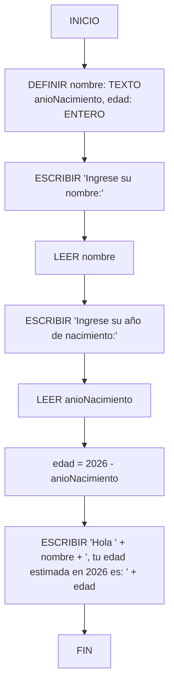
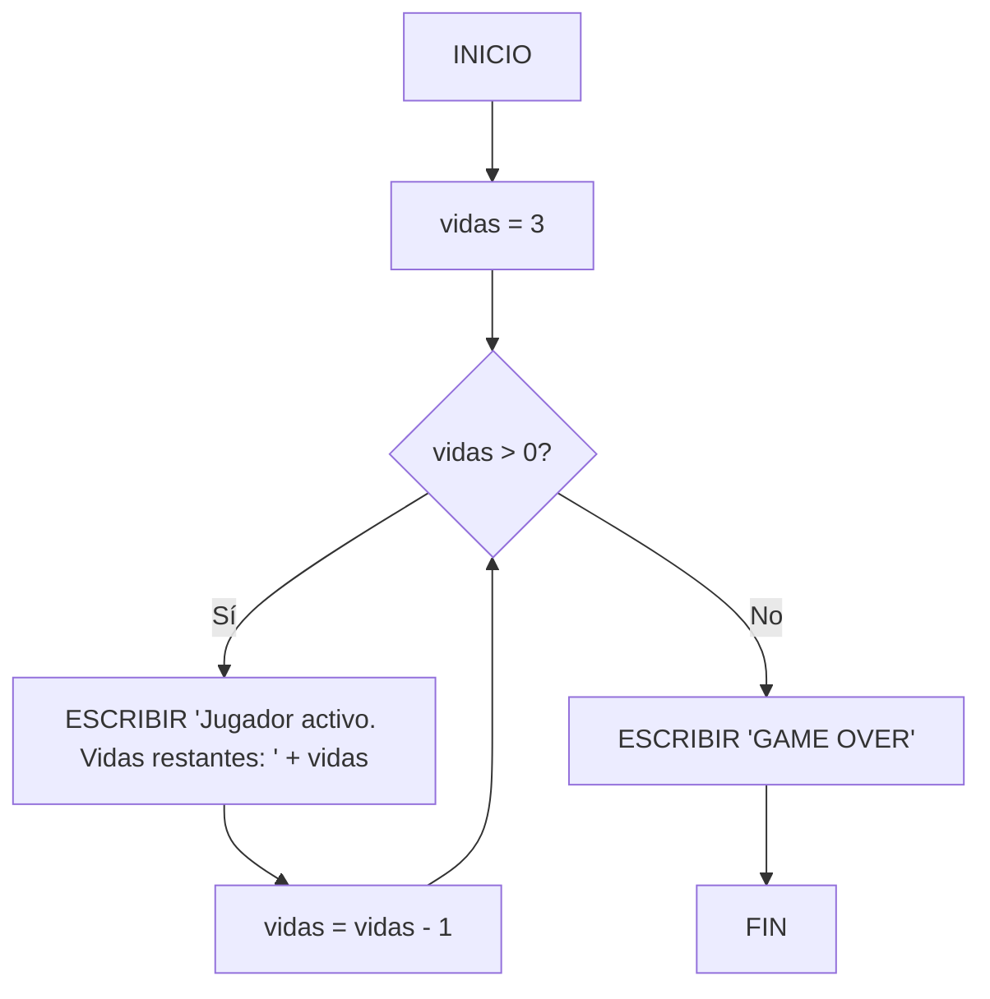
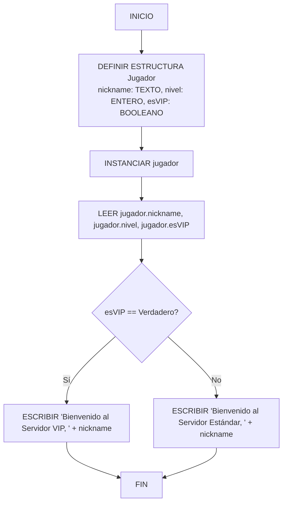

# ACTIVIDAD 9 — Práctica en papel: "Pensar antes de programar"

**Materia:** Laboratorio de Programación  
**Establecimiento:** EEST N.º 1 "Eduardo Ader" — Vicente López  
**Año:** 5.º año, 3.º Grupos A-B — 2026  
**Fecha límite de entrega:** 19 de noviembre de 2026

Este repositorio contiene la resolución en C++ de **todos los programas diagramados en la
actividad** (Ejercicios 0, 1, 2, 3 y 4), más la documentación de los algoritmos y sus
pruebas de escritorio. La idea central de la actividad es desacoplar el razonamiento
lógico del lenguaje: primero el diagrama de flujo y la simulación en papel, después
el código.

---

## Estructura del repositorio

```
/actividad-9-lpr/
├── .gitignore                      <- Exclusión de binarios (*.exe, *.out, .vscode/)
├── LICENSE                         <- Licencia MIT escolar
├── README.md                       <- Portada de la actividad y explicación técnica
├── docs/
│   └── InformeEEST1_LPR2026_ACT09_TuApellido_v1.0.0.pdf   <- Informe APA v7 (a cargo del estudiante)
├── src/
│   └── main.cpp                    <- Código fuente resuelto de referencia (los 5 ejercicios)
└── capturas/
    └── matriz_ejecucion.png        <- Captura de la ejecución en consola (a cargo del estudiante)
```

> **Nota:** los archivos `docs/*.pdf` y `capturas/*.png` son entregables personales
> (fotos de las hojas de carpeta + informe APA v7 y captura de pantalla). Las carpetas
> ya están creadas con un `.gitkeep` para que Git las versione; solo falta agregar tus
> archivos con el nombre indicado, reemplazando `TuApellido` por tu apellido real.

---

## Compilación y ejecución

Con GCC / MinGW:

```bash
g++ -std=c++17 -Wall -Wextra -o main src/main.cpp
./main
```

En Windows con PowerShell:

```powershell
g++ -std=c++17 -Wall -Wextra -o main.exe src\main.cpp
.\main.exe
```

El programa muestra un **menú** para elegir qué ejercicio ejecutar (opción `5` para salir).
Todos los algoritmos están en el mismo archivo `src/main.cpp`, cada uno en su propia
función (`ejercicio0()`, `ejercicio1()`, etc.).

---

## Los 5 programas diagramados

### Ejercicio 0 — "Hola Mundo" personalizado con cálculo de edad

Se leen nombre y año de nacimiento, se calcula `edad = 2026 - anioNacimiento` y se
muestra un saludo personalizado.



---

### Ejercicio 1 — El Sensor de Aprobación

Constante `NOTA_MINIMA = 6`. Se leen `nota1` y `nota2`, se calcula el promedio y un
rombo decide entre "APROBADO" y "A INTENSIFICACIÓN".

```mermaid
flowchart TD
    A[INICIO] --> B[NOTA_MINIMA = 6]
    B --> C[LEER nota1, nota2]
    C --> D[promedio = (nota1 + nota2) / 2]
    D --> E{promedio >= NOTA_MINIMA?}
    E -- Sí --> F[ESCRIBIR 'APROBADO']
    E -- No --> G[ESCRIBIR 'A INTENSIFICACIÓN']
    F --> H[FIN]
    G --> H
```

**Prueba de escritorio:**

| Caso | nota1 | nota2 | promedio | `promedio >= 6` | Salida |
|------|-------|-------|----------|-----------------|--------|
| A | 4 | 8 | 6 | Verdadero | APROBADO |
| B | 3 | 5 | 4 | Falso | A INTENSIFICACIÓN |

---

### Ejercicio 2 — El Bucle del Contador de Vidas

Se inicializa `vidas = 3`; el bucle `mientras vidas > 0` muestra las vidas restantes y
las decrementa. La flecha de retorno vuelve siempre a la evaluación de la condición.



**Prueba de escritorio:**

| Iteración | `vidas` al evaluar | Salida antes de decrementar | `vidas` al final |
|-----------|--------------------|-----------------------------|------------------|
| 1 | 3 | Jugador activo. Vidas restantes: 3 | 2 |
| 2 | 2 | Jugador activo. Vidas restantes: 2 | 1 |
| 3 | 1 | Jugador activo. Vidas restantes: 1 | 0 |
| — | 0 (condición falsa) | GAME OVER | 0 |

---

### Ejercicio 3 — Registro de Jugador en Memoria (`struct`)

Estructura `Jugador` con tres campos: `nickname` (texto), `nivel` (entero) y `esVIP`
(booleano). Se aclara en el enunciado interactivo que `1 = Verdadero` y `0 = Falso`.



**Bloque de memoria RAM del objeto:**

| campo | dirección relativa | valor (caso de prueba) |
|-------|--------------------|------------------------|
| `nickname` | inicio de `jugador` | `"Rothbard"` |
| `nivel` | + offset | `5` |
| `esVIP` | + offset | `Verdadero (`true`)` |

Salida esperada: `Bienvenido al Servidor VIP, Rothbard`.

---

### Ejercicio 4 — Control de Inventario con Arreglos

Vector predefinido `stock = [12, 0, 5, 30, 0]`. Se recorre con `i` desde 0 hasta 4;
cuando `stock[i] == 0` se emite una alerta indicando la posición.

```mermaid
flowchart TD
    A[INICIO] --> B[stock = 12, 0, 5, 30, 0]
    B --> C[i = 0]
    C --> D{i < 5?}
    D -- Sí --> E{stock[i] == 0?}
    E -- Sí --> F[ESCRIBIR 'ALERTA: Sin stock en la posición ' + i]
    E -- No --> G[i = i + 1]
    F --> G
    G --> D
    D -- No --> H[FIN]
```

**Prueba de escritorio:**

| `i` | `stock[i]` | ¿Es 0? | Acción |
|-----|------------|--------|--------|
| 0 | 12 | No | `i = 1` |
| 1 | 0 | Sí | ALERTA: Sin stock en la posición 1 → `i = 2` |
| 2 | 5 | No | `i = 3` |
| 3 | 30 | No | `i = 4` |
| 4 | 0 | Sí | ALERTA: Sin stock en la posición 4 → `i = 5` |
| 5 | — | — | Fin del bucle |

---

## Enlaces técnicos de referencia (según la actividad)

- [GeeksforGeeks — Arreglos multidimensionales en C++](https://www.geeksforgeeks.org/multidimensional-arrays-c-cpp/)
- [cplusplus.com — Herencia y modificadores de acceso (`protected`)](https://cplusplus.com/doc/tutorial/inheritance/)
- [Microsoft Learn — Constructores y clases derivadas](https://learn.microsoft.com/es-es/cpp/cpp/constructors-cpp)
- [Git Documentation — Control de versiones](https://git-scm.com/doc)
